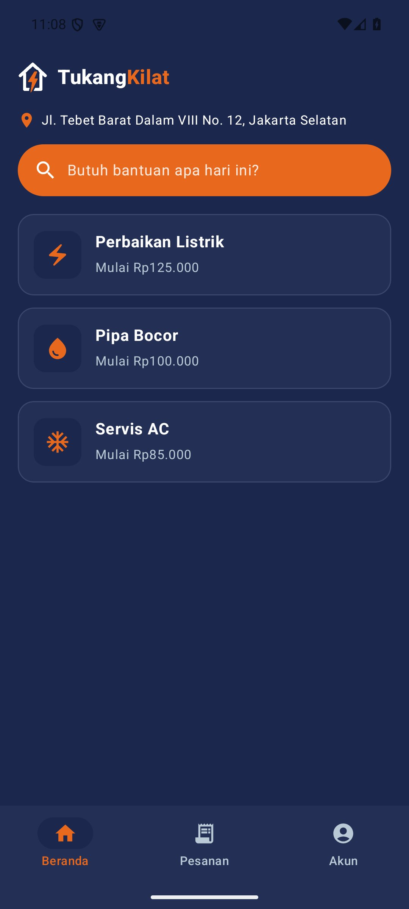
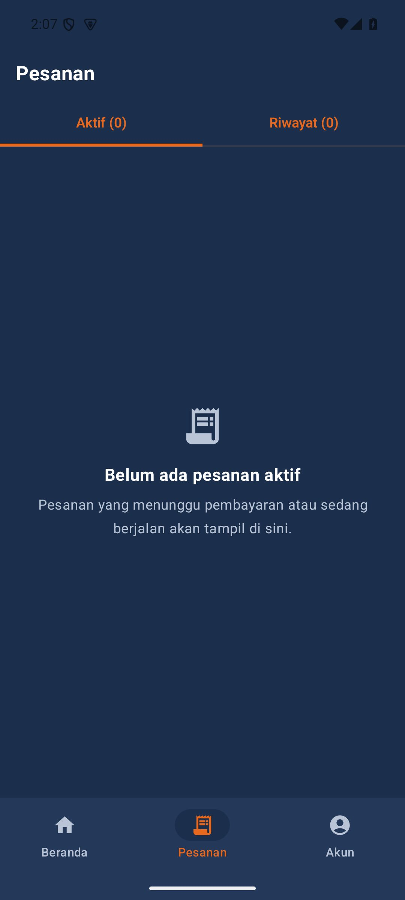
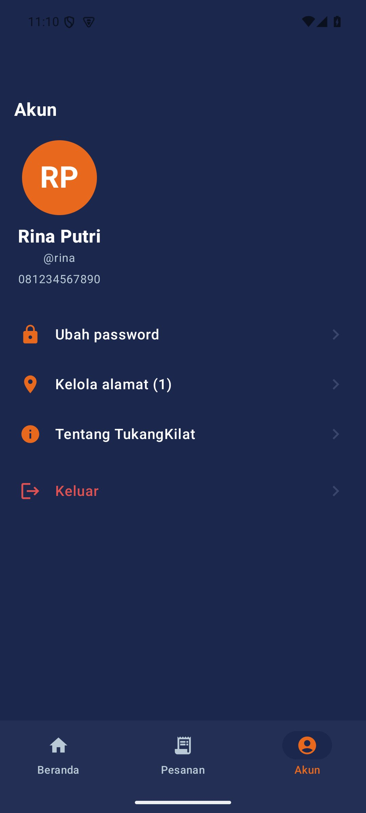

<div align="center">
  
  <h1>Tukang Kilat: Ahlinya rumah, siap membantu</h1>
  <p><b>A native Android app to book trusted home technicians:<br/>
  electricians, plumbers, and AC technicians, with transparent prices and live tracking.</b></p>

  <a href="https://github.com/nekonaru/tukangkilat/releases"></a>
  <a href="https://github.com/nekonaru/tukangkilat/actions/workflows/ci.yml"></a>
  
  
  
  
</div>

<br />

**English** | [Bahasa Indonesia](README.md)

> [!NOTE]
> Tukang Kilat is a college final project (tugas akhir) and is distributed as a sideloaded APK, not via the Play Store. All payment flows run on a built-in simulator; no real money is involved.

---

## Table of Contents

- [About](#about)
- [Screenshots](#screenshots)
- [Features](#features)
- [Architecture](#architecture)
- [Requirements](#requirements)
- [Installation](#installation)
- [Usage](#usage)
- [Data Sources](#data-sources)
- [Project Structure](#project-structure)
- [Development](#development)
- [Testing](#testing)
- [Continuous Integration](#continuous-integration)
- [FAQ](#faq)
- [Author](#author)
- [Disclaimer](#disclaimer)
- [License](#license)

---

## About

**Tukang Kilat** connects consumers with verified home technicians: electricians, plumbers, and AC technicians. Consumers see the price up front, track the technician live on the map, and get photo proof of the work before confirming and paying. Technicians get an orderly queue of jobs, proof of completed work, and a measurable reputation. Admins verify technicians and handle problem reports.

> _"Bantuan datang ke rumah, dan datang cepat."_
>
> _"Help arrives at your door, and arrives fast."_

---

## Screenshots

| Beranda | Pesanan | Akun |
|---------|---------|------|
|  |  |  |
| Service list with starting prices | Active orders and history | Profile and saved addresses |

---

## Features

### For consumers

| Feature | Description |
|---------|-------------|
| **Book in minutes** | From home screen to paid order in a few taps |
| **Transparent pricing** | Total = service fee + visit fee, visible before you pay |
| **Live tracking** | Real-time map with the technician's position, ETA, and timeline |
| **Proof of work** | Photo evidence and the technician's note shown before you confirm |
| **Ratings** | 1-5 stars, quick tags, and comment after the work is done |
| **Problem reports** | Request a revisit with 3 reasons and photo evidence |
| **PDF receipt** | Share a completed order's receipt as a PDF file using built-in Android APIs |
| **Promo codes** | Save money with `HEMAT25` (simulator demo) or promos created from the admin panel |
| **Chat** | Two-way chat with the technician, per order |

### For technicians

| Feature | Description |
|---------|-------------|
| **Real-time offers** | Offers arrive with a 60-second countdown over WebSocket |
| **Online/offline toggle** | Only online technicians receive offers |
| **Skills and radius** | Set your skills (listrik, pipa, AC) and service radius |
| **Ordered job actions** | Depart, arrive, start work, finish with photo proof |
| **Earnings** | Per-job breakdown: fee, 15% platform commission, full visit fee |
| **Ratings and reviews** | Profile shows rating average and jobs completed, plus a list of reviews (stars, tags, comment, date) |

### For admins

| Feature | Description |
|---------|-------------|
| **Verify technicians** | Approve or reject registrations with KTP and selfie photos |
| **Problem reports** | View reports, schedule a revisit, or close them |
| **Payment simulation** | "Simulasikan berhasil/gagal" buttons for transfer and e-wallet demos |
| **Manage services** | Edit name, price, visit fee, and active status |
| **Manage promo codes** | Create, activate and deactivate promo codes from the admin panel |
| **Suspend accounts** | Suspend or re-activate technician and consumer accounts |
| **Export and import database** | Save all data and photos to a zip file, then restore it on another device from the admin panel |

---

## Architecture

Since v2.0.0 the whole backend (Ktor, Exposed, H2 in PostgreSQL mode) runs inside the app process. Data lives in device storage. The app calls a local API on `127.0.0.1:8080`, so the demo needs no server, Docker or internet connection. Each device has its own database, so moving data between devices uses exported zip files rather than live sync.

---

## Requirements

| Dependency | Minimum Version | Notes |
|------------|-----------------|-------|
| **Android device or emulator** | Android 8.0 (API 26) | Runs the app |
| **JDK** | 21 | Required only to build from source |
| **Android SDK** | compileSdk 36 | Required only to build from source |
| **Docker with Docker Compose** | any recent version | Required to run PostgreSQL locally |
| **Gradle** | 8.13 (wrapper included) | Required only to build from source |

> [!TIP]
> If you only want to use the app, you do not need the JDK, the Android SDK, or Docker. Download the APK from the [Releases](https://github.com/nekonaru/tukangkilat/releases) page instead.

### Never used a terminal? Start here

<details>
<summary><b>How to open a terminal on Windows</b></summary>

1. Press the **Windows** key, type `PowerShell`, then press **Enter**
2. A blue window opens. That is where you type commands
3. Every command in this guide is typed in that window, followed by **Enter**

</details>

---

## Installation

### Option A: Download the APK (easiest)

1. Open the [Releases](https://github.com/nekonaru/tukangkilat/releases) page
2. Download the APK attached to the latest release
3. Open it on your phone, allow installs from unknown sources if asked
4. Wait for the "Menyiapkan aplikasi..." screen to finish, then log in with a demo account below

> [!NOTE]
> Since v2.0.0 the backend runs inside the APK. Docker, PostgreSQL and a separate server are no longer needed to use the app. Data is stored on the device. **Atur alamat server** remains available only for development against a remote backend.

Demo accounts (seeded, passwords from `.env`; defaults shown for local development):

| Role | Username | Password |
|------|----------|----------|
| Consumer | `rina` | `rina12345` |
| Technician (verified) | `budi` | `budi12345` |
| Technician (verified) | `sari` | `sari12345` |
| Admin | `admin` | `admin12345` |

> [!IMPORTANT]
> These are demo credentials for the local backend only. Change `DEMO_*_PASSWORD` in `.env` before deploying anywhere real.

### Option B: Build from source (for development / to read or change the code)

#### 1. Get the project code

<details>
<summary><b>I have Git installed</b></summary>

1. Open a terminal and clone the repository:

   ```bash
   git clone https://github.com/nekonaru/tukangkilat.git
   cd tukangkilat
   ```

2. Copy the environment template and adjust if needed:

   ```bash
   cp .env.example .env
   ```

</details>

<details>
<summary><b>I don't have Git</b></summary>

1. Download the repository as a ZIP from the [code page](https://github.com/nekonaru/tukangkilat) and extract it
2. Open a terminal in the extracted folder
3. Copy the environment template: `cp .env.example .env`

</details>

#### 2. Start the backend

1. Start PostgreSQL:

   ```bash
   docker compose up -d db
   ```

2. Run the backend:

   ```bash
   ./gradlew :backend:run
   ```

   The backend applies migrations and seeds the demo accounts automatically when the database is empty. It serves on `http://localhost:8080`.

#### 3. Build and run the Android app

1. Install the debug APK on a device or emulator:

   ```bash
   ./gradlew :app:installDebug
   ```

   Or build the APK only:

   ```bash
   ./gradlew :app:assembleDebug
   ```

2. Launch the app and log in with a demo account.

> [!IMPORTANT]
> The emulator reaches the host backend through `10.0.2.2`. The `BASE_URL` used by the app defaults to `http://10.0.2.2:8080` and can be overridden: `./gradlew :app:assembleDebug -PbaseUrl=http://<your-lan-ip>:8080`.

---

## Usage

### First launch

1. Open the app. You land on the login screen
2. Log in with a demo account or register with **Daftar**
3. The app reads the role from the server and opens the right interface: consumer, technician, or admin

### Everyday use

- **Consumer:** choose a service, tell the problem, pick a schedule, pay (or choose cash), track the technician live, confirm the work, and rate it
- **Technician:** toggle Online, accept offers, Depart, Arrive, Start work, Finish with photo proof
- **Admin:** verify technicians, handle reports, and trigger payment simulation for transfer and e-wallet demos

---

## Data Sources

| Purpose | Source |
|---------|--------|
| Map tiles | OpenStreetMap contributors, via osmdroid (no API key) |
| Service icons | Material Icons (built into the app) |
| Demo data | Seeded by the backend from `.env` (`DEMO_*_PASSWORD`) |

> [!NOTE]
> All operational data (users, orders, services, payments) lives in the local PostgreSQL database created by `docker compose`. No third-party analytics, no telemetry.

---

## Project Structure

```
tukangkilat/
  app/             Android app: ui/consumer, ui/technician, ui/admin, data, di
  backend/         Ktor backend: routes, services, Exposed tables, Flyway migrations
  shared/          Shared Kotlin module: DTOs, enums, OrderStateMachine
  docker-compose.yml   PostgreSQL service
  docs/            PRD, ERD, state machine, design audit, screenshots
  assets/          Brand assets for documentation (README logo)
  scripts/         verify.sh (local CI gate)
  README.en.md     This file (English)
  README.md        Indonesian version
```

---

## Development

### Change the UI text or add a screen

1. Edit the composable under `app/src/main/kotlin/id/tukangkilat/app/ui/<role>/`
2. Follow the design tokens in `ui/theme/Color.kt`; do not hardcode colors
3. UI text stays in Bahasa Indonesia; code identifiers and comments stay in English

### Change an order rule

1. Edit `shared/src/main/kotlin/id/tukangkilat/shared/OrderStateMachine.kt` and keep the tables in `docs/PRD.md` and `docs/STATE_MACHINE.md` in sync
2. Update the unit tests in the same module
3. Run the backend integration tests: `./gradlew :backend:test`

### Add a database migration

1. Add a `V<next>__name.sql` file under `backend/src/main/resources/db/migration/`
2. Flyway applies it automatically on the next startup

> [!WARNING]
> Never edit a migration that has already been applied. Add a new one instead. Generated files under `build/` are rebuilt on every compile; do not edit them.

---

## Testing

```bash
./gradlew :shared:test :backend:test :app:assembleDebug
```

| Check | Requirement |
|-------|-------------|
| Unit tests (`shared`) | All valid and invalid `OrderStateMachine` transitions, and price/promo calculation |
| Integration tests (`backend`) | Full flow: register, login, order, pay (simulation), offer accepted, technician actions, confirm, rate, RBAC, IDOR access checks |
| Android build (`app`) | `assembleDebug` is green |

---

## Continuous Integration

| Workflow | Purpose |
|----------|---------|
| `ci.yml` | Backend and shared tests, Android debug build, gitleaks secret scan |

CI runs on pushes to `main`, on pull requests, and on `v*` tags.

---

## FAQ

<details>
<summary><b>Does this app use real payments?</b></summary>

No. All payments go through `SimulatorProvider`. An admin marks a demo transfer or e-wallet payment as successful or failed from the admin panel. Cash is handled by the technician at the doorstep.
</details>

<details>
<summary><b>Why is the same account possible on two phones?</b></summary>

Each device gets its own tokens. Refresh tokens are single-use and rotated; logging out revokes them. Sessions do not sync private data across devices beyond the shared account.
</details>

<details>
<summary><b>How do I unlock the demo accounts after too many failed logins?</b></summary>

Wait 5 minutes, or reset the local database (`docker compose down -v && docker compose up -d db`, then `./gradlew :backend:run`) to reseed the demo accounts.
</details>

<details>
<summary><b>The app cannot reach the backend. What now?</b></summary>

Make sure the backend is running (`http://localhost:8080/health` answers `{"status":"ok"}`), the emulator uses `10.0.2.2` or a LAN IP via `-PbaseUrl=`, and the cleartext config in `app/src/main/res/xml/network_security_config.xml` covers it.
</details>

---

## Author

<div align="center">

| [](https://github.com/nekonaru) |
|:---:|
| **[Nicolas Dwi Dharma](https://github.com/nekonaru)** |

</div>

---

## Disclaimer

Tukang Kilat is a college final project. It is not affiliated with any property or service company. All prices, services, and demo accounts are illustrative.

---

## License

Distributed under the **MIT License**. See [`LICENSE`](LICENSE) for more information.
