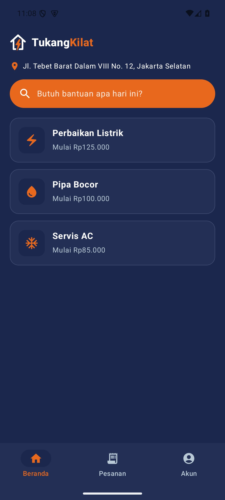
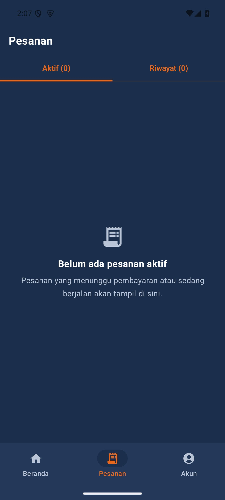
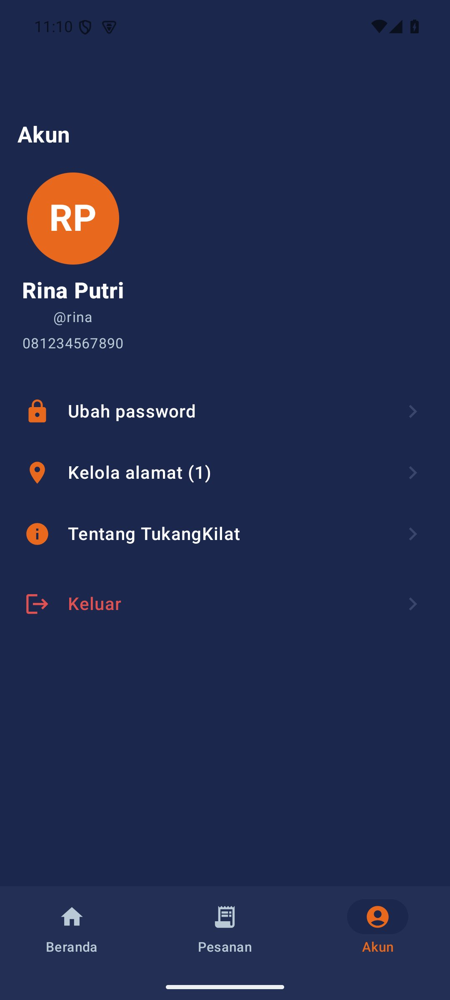

<div align="center">
  
  <h1>Tukang Kilat: Ahlinya rumah, siap membantu</h1>
  <p><b>Aplikasi Android native untuk memesan teknisi rumah tepercaya,<br/>
  listrik, pipa, dan AC, dengan harga transparan dan pelacakan langsung.</b></p>

  <a href="https://github.com/nekonaru/tukangkilat/releases"></a>
  <a href="https://github.com/nekonaru/tukangkilat/actions/workflows/ci.yml"></a>
  
  
  
  
</div>

<br />

**Bahasa Indonesia** | [English](README.en.md)

> [!NOTE]
> Tukang Kilat adalah tugas akhir kuliah dan didistribusikan sebagai APK sideload, bukan lewat Play Store. Semua alur pembayaran berjalan di simulator bawaan; tidak ada uang nyata yang terlibat.

---

## Daftar Isi

- [Tentang](#tentang)
- [Tangkapan Layar](#tangkapan-layar)
- [Fitur](#fitur)
- [Arsitektur](#arsitektur)
- [Persyaratan](#persyaratan)
- [Instalasi](#instalasi)
- [Cara Pakai](#cara-pakai)
- [Sumber Data](#sumber-data)
- [Struktur Proyek](#struktur-proyek)
- [Pengembangan](#pengembangan)
- [Pengujian](#pengujian)
- [Continuous Integration](#continuous-integration)
- [FAQ](#faq)
- [Penulis](#penulis)
- [Disclaimer](#disclaimer)
- [Lisensi](#lisensi)

---

## Tentang

**Tukang Kilat** mempertemukan konsumen dengan teknisi rumah terverifikasi: listrik, pipa, dan servis AC. Konsumen tahu harga di muka, bisa melacak kedatangan teknisi secara langsung di peta, dan punya bukti foto hasil pekerjaan sebelum mengonfirmasi dan membayar. Teknisi mendapat antrean pesanan yang rapi, bukti pekerjaan selesai, dan reputasi yang terukur. Admin memverifikasi teknisi dan menangani laporan masalah.

> _"Bantuan datang ke rumah, dan datang cepat."_

---

## Tangkapan Layar

| Beranda | Pesanan | Akun |
|---------|---------|------|
|  |  |  |
| Daftar layanan dengan harga mulai | Pesanan aktif dan riwayat | Profil dan alamat tersimpan |

---

## Fitur

### Untuk konsumen

| Fitur | Deskripsi |
|-------|-----------|
| **Pesan dalam menit** | Dari Beranda sampai pembayaran selesai dalam beberapa langkah |
| **Harga transparan** | Total = biaya jasa + biaya kunjungan, terlihat sebelum bayar |
| **Pelacakan langsung** | Peta posisi teknisi bergerak, estimasi tiba, dan linimasa |
| **Bukti kerja** | Foto bukti dan catatan teknisi tampil sebelum konfirmasi |
| **Penilaian** | Bintang 1-5, tag cepat, dan komentar setelah pekerjaan selesai |
| **Lapor masalah** | Minta kunjungan ulang dengan 3 alasan dan foto bukti |
| **Kode promo** | Hemat biaya dengan `HEMAT25` (demo simulator) atau promo yang dibuat dari panel admin |
| **Chat** | Obrolan dua arah dengan teknisi, per pesanan |

### Untuk tukang

| Fitur | Deskripsi |
|-------|-----------|
| **Tawaran real-time** | Tawaran masuk dengan hitung mundur 60 detik lewat WebSocket |
| **Sakelar online/offline** | Hanya teknisi online yang menerima tawaran |
| **Keahlian dan radius** | Atur keahlian (listrik, pipa, AC) dan radius layanan |
| **Aksi pekerjaan berurutan** | Berangkat, tiba, mulai bekerja, selesaikan dengan foto bukti |
| **Pendapatan** | Rincian per pekerjaan: tarif, komisi platform 15%, biaya kunjungan penuh |
| **Ratings dan ulasan** | Profil menampilkan rating rata-rata, jumlah pekerjaan, dan daftar ulasan (bintang, tag, komentar, tanggal) |

### Untuk admin

| Fitur | Deskripsi |
|-------|-----------|
| **Verifikasi tukang** | Setujui atau tolak pendaftaran dengan foto KTP dan selfie |
| **Laporan masalah** | Lihat laporan, jadwalkan kunjungan ulang, atau tutup |
| **Simulasi pembayaran** | Tombol "Simulasikan berhasil/gagal" untuk demo transfer dan dompet digital |
| **Kelola layanan** | Ubah nama, harga, biaya kunjungan, dan status aktif |
| **Kelola kode promo** | Buat, aktifkan, dan nonaktifkan kode promo dari panel admin |
| **Tangguhkan akun** | Tangguhkan atau aktifkan kembali akun tukang dan konsumen |
| **Ekspor/impor database** | Simpan seluruh data dan foto ke file zip, lalu pulihkannya di perangkat lain lewat panel admin |

---

## Arsitektur

Sejak v2.0.0 seluruh backend (Ktor, Exposed, H2 dalam mode PostgreSQL) berjalan di dalam proses aplikasi. Data disimpan di penyimpanan internal perangkat. Aplikasi memanggil API lokal di `127.0.0.1:8080`, jadi tidak memerlukan server, Docker, atau koneksi internet untuk alur demo. Karena tiap perangkat punya database sendiri, perpindahan data antarperangkat dilakukan lewat ekspor dan impor file zip, bukan sinkronisasi langsung.

---

## Persyaratan

| Ketergantungan | Versi Minimum | Catatan |
|----------------|---------------|---------|
| **Perangkat Android atau emulator** | Android 8.0 (API 26) | Menjalankan aplikasi |
| **JDK** | 21 | Hanya dibutuhkan untuk build dari source |
| **Android SDK** | compileSdk 36 | Hanya dibutuhkan untuk build dari source |
| **Docker dengan Docker Compose** | versi terbaru | Hanya dibutuhkan untuk PostgreSQL lokal |
| **Gradle** | 8.13 (wrapper disertakan) | Hanya dibutuhkan untuk build dari source |

> [!TIP]
> Jika kamu hanya ingin memakai aplikasinya, JDK, Android SDK, dan Docker tidak diperlukan. Unduh APK dari halaman [Releases](https://github.com/nekonaru/tukangkilat/releases).

### Belum pernah pakai terminal? Mulai di sini

<details>
<summary><b>Cara membuka terminal di Windows</b></summary>

1. Tekan tombol **Windows**, ketik `PowerShell`, lalu tekan **Enter**
2. Jendela biru akan terbuka. Di situlah kamu mengetik perintah
3. Setiap perintah di panduan ini diketik di jendela itu, lalu tekan **Enter**

</details>

---

## Instalasi

### Opsi A: Unduh APK (termudah)

1. Buka halaman [Releases](https://github.com/nekonaru/tukangkilat/releases)
2. Unduh APK yang terlampir pada rilis terbaru
3. Buka di ponselmu, izinkan instalasi dari sumber tidak dikenal bila diminta
4. Tunggulayar "Menyiapkan aplikasi..." selesai, lalu masuk dengan akun demo di bawah

> [!NOTE]
> Sejak v2.0.0 backend berjalan di dalam APK. Tidak perlu Docker, PostgreSQL, atau server terpisah untuk memakai aplikasi. Data disimpan di perangkat. Menu **Atur alamat server** tetap tersedia hanya untuk pengembangan dengan backend jarak jauh.

Akun demo (di-seed, password dari `.env`; default ditampilkan untuk pengembangan lokal):

| Peran | Username | Password |
|-------|----------|----------|
| Konsumen | `rina` | `rina12345` |
| Teknisi (terverifikasi) | `budi` | `budi12345` |
| Teknisi (terverifikasi) | `sari` | `sari12345` |
| Admin | `admin` | `admin12345` |

> [!IMPORTANT]
> Ini adalah kredensial demo untuk backend lokal. Ubah `DEMO_*_PASSWORD` di `.env` sebelum men-deploy ke mana pun.

### Opsi B: Build dari source (untuk development / membaca atau mengubah kode)

#### 1. Ambil kode proyek

<details>
<summary><b>Saya sudah instal Git</b></summary>

1. Buka terminal dan clone repositori:

   ```bash
   git clone https://github.com/nekonaru/tukangkilat.git
   cd tukangkilat
   ```

2. Salin template environment dan sesuaikan bila perlu:

   ```bash
   cp .env.example .env
   ```

</details>

<details>
<summary><b>Saya belum instal Git</b></summary>

1. Unduh repositori sebagai ZIP dari [halaman kode](https://github.com/nekonaru/tukangkilat) lalu ekstrak
2. Buka terminal di folder hasil ekstrak
3. Salin template environment: `cp .env.example .env`

</details>

#### 2. Jalankan backend

1. Nyalakan PostgreSQL:

   ```bash
   docker compose up -d db
   ```

2. Jalankan backend:

   ```bash
   ./gradlew :backend:run
   ```

   Backend menerapkan migrasi dan men-seed akun demo otomatis saat database kosong. Backend berjalan di `http://localhost:8080`.

#### 3. Build dan jalankan aplikasi Android

1. Instal APK debug ke perangkat atau emulator:

   ```bash
   ./gradlew :app:installDebug
   ```

   Atau build APK saja:

   ```bash
   ./gradlew :app:assembleDebug
   ```

2. Buka aplikasi dan masuk dengan akun demo.

> [!IMPORTANT]
> Emulator mengakses backend di host melalui `10.0.2.2`. `BASE_URL` yang dipakai aplikasi default ke `http://10.0.2.2:8080` dan bisa di-override: `./gradlew :app:assembleDebug -PbaseUrl=http://<ip-lan-kamu>:8080`.

---

## Cara Pakai

### Saat pertama dibuka

1. Buka aplikasi. Kamu akan mendarat di layar login
2. Masuk dengan akun demo atau daftar dengan **Daftar**
3. Aplikasi membaca peran dari server dan membuka antarmuka yang sesuai: konsumen, tukang, atau admin

### Pemakaian sehari-hari

- **Konsumen:** pilih layanan, ceritakan masalahnya, pilih jadwal, bayar (atau pilih tunai), lacak teknisi secara langsung, konfirmasi hasil, lalu beri penilaian
- **Tukang:** aktifkan Online, terima tawaran, Berangkat, Saya sudah tiba, Mulai bekerja, Selesaikan dengan foto bukti
- **Admin:** verifikasi teknisi, tangani laporan, dan picu simulasi pembayaran untuk demo transfer dan e-wallet

---

## Sumber Data

| Keperluan | Sumber |
|-----------|--------|
| Tile peta | Kontributor OpenStreetMap, lewat osmdroid (tanpa API key) |
| Ikon layanan | Material Icons (bawaan aplikasi) |
| Data demo | Di-seed backend dari `.env` (`DEMO_*_PASSWORD`) |

> [!NOTE]
> Semua data operasional (pengguna, pesanan, layanan, pembayaran) tersimpan di PostgreSQL lokal yang dibuat oleh `docker compose`. Tidak ada analitik pihak ketiga, tidak ada telemetri.

---

## Struktur Proyek

```
tukangkilat/
  app/             Aplikasi Android: ui/consumer, ui/technician, ui/admin, data, di
  backend/         Backend Ktor: routes, services, tabel Exposed, migrasi Flyway
  shared/          Modul Kotlin bersama: DTO, enum, OrderStateMachine
  docker-compose.yml   Layanan PostgreSQL
  docs/            PRD, ERD, diagram status, audit desain, tangkapan layar
  assets/          Aset merek untuk dokumentasi (logo README)
  scripts/         verify.sh (gerbang CI lokal)
  README.en.md     Versi Inggris
  README.md        Berkas ini (Bahasa Indonesia)
```

---

## Pengembangan

### Mengubah teks UI atau menambah layar

1. Edit composable di `app/src/main/kotlin/id/tukangkilat/app/ui/<peran>/`
2. Ikuti design token di `ui/theme/Color.kt`; jangan hardcode warna
3. Teks UI tetap Bahasa Indonesia; identifier kode dan komentar tetap Bahasa Inggris

### Mengubah aturan pesanan

1. Edit `shared/src/main/kotlin/id/tukangkilat/shared/OrderStateMachine.kt` dan jaga sinkron tabel di `docs/PRD.md` dan `docs/STATE_MACHINE.md`
2. Perbarui unit test di modul yang sama
3. Jalankan integrasi backend: `./gradlew :backend:test`

### Menambah migrasi database

1. Tambahkan berkas `V<berikutnya>__nama.sql` di `backend/src/main/resources/db/migration/`
2. Flyway menerapkannya otomatis saat startup berikutnya

> [!WARNING]
> Jangan pernah mengedit migrasi yang sudah diterapkan. Buat migrasi baru. Berkas di folder `build/` dibangun ulang setiap compile; jangan diedit.

---

## Pengujian

```bash
./gradlew :shared:test :backend:test :app:assembleDebug
```

| Pemeriksaan | Kebutuhan |
|-------------|-----------|
| Unit test (`shared`) | Semua transisi OrderStateMachine yang sah dan tidak sah, serta perhitungan biaya dan promo |
| Integrasi (`backend`) | Alur lengkap: register, login, pesan, bayar (simulasi), terima tawaran, aksi tukang, konfirmasi, nilai, RBAC, akses IDOR |
| Build Android (`app`) | `assembleDebug` hijau |

---

## Continuous Integration

| Workflow | Tujuan |
|----------|--------|
| `ci.yml` | Test backend dan shared, build debug Android, scan rahasia gitleaks |

CI berjalan pada push ke `main`, pada pull request, dan pada tag `v*`.

---

## FAQ

<details>
<summary><b>Apakah aplikasi ini memakai pembayaran sungguhan?</b></summary>

Tidak. Semua pembayaran lewat `SimulatorProvider`. Admin menandai pembayaran transfer atau e-wallet demo sebagai berhasil atau gagal dari panel admin. Uang tunai ditangani teknisi di lokasi.
</details>

<details>
<summary><b>Kenapa akun yang sama bisa masuk di dua ponsel?</b></summary>

Setiap perangkat mendapat token sendiri. Refresh token bersifat single-use dan dirotasi; logout mencabutnya. Sesi tidak menyinkronkan data pribadi antar perangkat selain akun yang sama.
</details>

<details>
<summary><b>Bagaimana cara membuka kunci akun demo setelah terlalu banyak gagal login?</b></summary>

Tunggu 5 menit, atau reset database lokal (`docker compose down -v && docker compose up -d db`, lalu `./gradlew :backend:run`) untuk men-seed ulang akun demo.
</details>

<details>
<summary><b>Aplikasi tidak bisa terhubung ke backend. Kenapa?</b></summary>

Pastikan backend berjalan (`http://localhost:8080/health` menjawab `{"status":"ok"}`), emulator memakai `10.0.2.2` atau IP LAN lewat `-PbaseUrl=`, dan konfigurasi cleartext di `app/src/main/res/xml/network_security_config.xml` mencakupnya.
</details>

---

## Penulis

<div align="center">

| [](https://github.com/nekonaru) |
|:---:|
| **[Nicolas Dwi Dharma](https://github.com/nekonaru)** |

</div>

---

## Disclaimer

Tukang Kilat adalah tugas akhir kuliah. Tidak berafiliasi dengan perusahaan properti atau jasa mana pun. Semua harga, layanan, dan akun demo bersifat ilustratif.

---

## Lisensi

Didistribusikan di bawah **Lisensi MIT**. Lihat [`LICENSE`](LICENSE) untuk informasi lebih lanjut.
