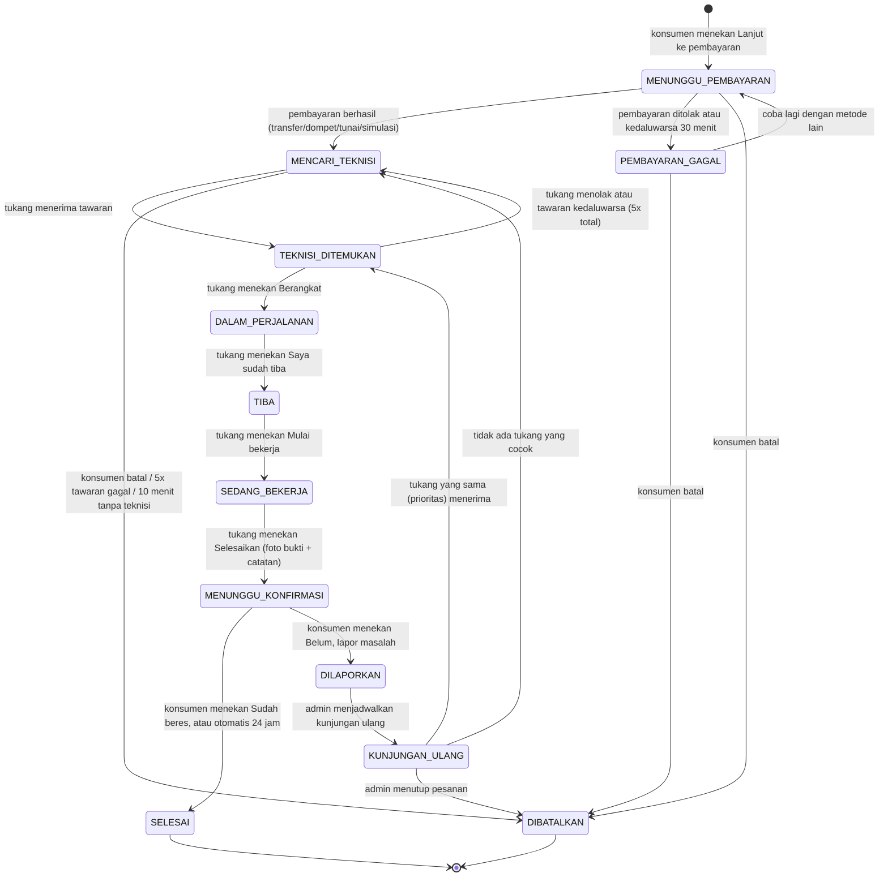

# Diagram status pesanan

Alur mengikuti PRD bagian 4. Semua transisi terjadi lewat `OrderService` di backend, dalam transaksi database, dan selalu menulis baris `order_events`.

## Aturan bisnis penting

- Hanya server yang boleh mengubah status. Setiap transisi divalidasi oleh `canTransition(from, to, actor)` dari modul `shared`, dalam satu transaksi, lalu menulis `order_events` dan mem-broadcast WebSocket.
- Pelanggaran transisi dikembalikan sebagai HTTP 409 dengan kode `ILLEGAL_TRANSITION`.
- Tawaran ke tukang kedaluwarsa dalam 60 detik. Satu pesanan maksimal 5 kali tawaran; tukang yang sudah ditawar tidak ditawar lagi dalam siklus yang sama.
- `reschedule` membersihkan semua tawaran aktif lalu memulai siklus penugasan ulang dari nol.
- Kunjungan ulang memilih tukang yang sama sebagai kandidat pertama (prioritas), bukan sebagai kandidat eksklusif.
- Tidak ada uang nyata bergerak. Semua pembayaran memakai `SimulatorProvider`; "berhasil" dan "gagal" dipicu lewat endpoint admin `POST /admin/payments/{orderId}/simulate-success` dan `simulate-fail`.
